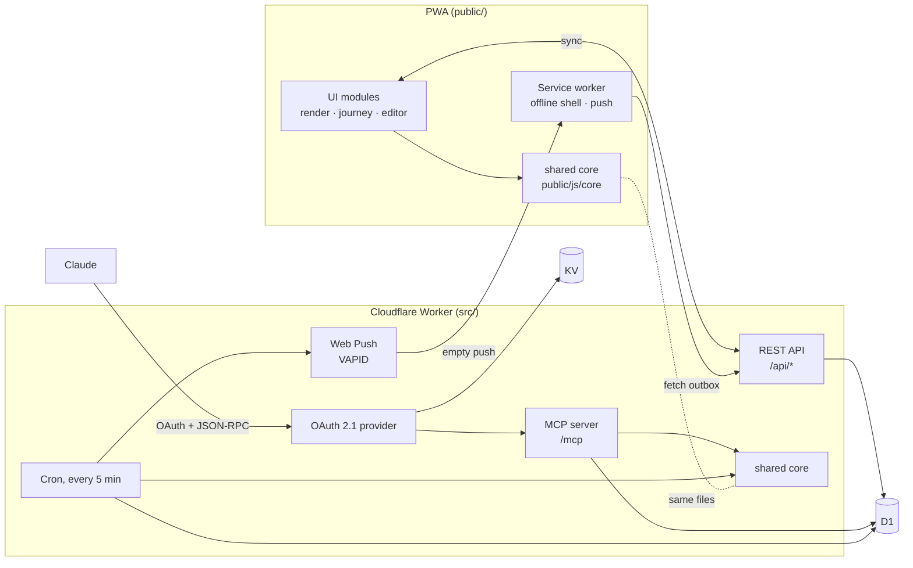

# Quest Log

[](https://github.com/jerry-vrabel-development/quest-log/actions/workflows/ci.yml)

A gamified, ADHD-friendly task tracker. Each quest has a **tiny first step** for when you feel frozen. Completing quests rolls **variable-ratio loot**, with a pity timer so a dry streak never lasts long. The app also has gentle streaks, a 1–10 mood check-in, badges, and a Journey tab that shows how mood and activity relate.

It is an installable PWA that works offline. A Cloudflare Worker adds device sync, push reminders that arrive while the app is closed, and a **Claude connector**: a remote MCP server behind OAuth 2.1, so an AI assistant can add, schedule and complete quests from a conversation.

**Live:** https://quest-log.forwardslash.workers.dev

## Architecture



**One rulebook, three callers.** The game rules live in `public/js/core/`: dates and repeats, XP curve, loot table, streaks, badges and reminder timing. They are plain, dependency-free ES modules. The browser loads them directly with no build step. The Worker imports the same files, so Wrangler bundles them into the server. A quest completed through Claude, a reminder sent by the cron, and a checkbox ticked in the app all go through the same code.

**Time-zone-safe dates.** Dates are `YYYY-MM-DD` strings in the user's calendar, and the math runs on UTC `Date`s. The phone, the Worker and CI therefore agree no matter where each one runs. The test suite runs under several machine time zones to prove it.

**Rewards stay where the user sees them.** When Claude completes a quest, the server adds the XP right away and queues a pending reward. The loot roll and badge check happen the next time the app opens, so the reward moment still happens in the app.

## Project layout

```
public/                     the PWA (static, no build step)
  index.html, styles.css, sw.js
  js/main.js                entry point: wiring and boot
  js/{render,journey,editor,settings,reminders,sync,actions,toast,store,dom}.js
  js/core/                  pure logic shared with the Worker (JSDoc-typed, type-checked)
    dates.js                calendar math, repeat rules, DST-aware zone conversion
    rules.js                XP curve, streaks, loot roll, completing quests, moods
    stats.js                derived stats and badges
    quests.js               views, sorting, roll-forward of missed repeats, input validation
    reminders.js            when a reminder fires (used by app and cron)
    state.js                fresh state, migrations, normalization
    ics.js                  calendar export with alarms
src/                        the Cloudflare Worker
  worker.js                 entry: OAuth provider in front of /mcp, cron handler
  api.js                    /api/* routes (sync, push subscriptions, outbox)
  authorize.js              OAuth consent page (proves ownership with the sync code)
  mcp/server.js             MCP over Streamable HTTP, stateless JSON-RPC 2.0
  mcp/tools.js              tool schemas and implementations
  reminders.js, push.js     reminder cron and VAPID Web Push
  db.js                     every SQL statement, in one place
test/unit/                  core logic
test/worker/                API, MCP, cron, push and the full OAuth flow against real SQLite
e2e/                        Playwright tests on desktop and mobile viewports
```

## Testing and quality

| Command                                                       | What it does                                                                                                                                                |
| ------------------------------------------------------------- | ----------------------------------------------------------------------------------------------------------------------------------------------------------- |
| `npm test`                                                    | 120 Vitest tests: unit tests for the core, plus Worker tests that run the real `schema.sql` on Node's built-in SQLite through a small D1-compatible adapter |
| `npm run test:e2e`                                            | Playwright on Desktop Chrome and Pixel 7: first run, completing quests, mood check-ins, the editor, Journey                                                 |
| `npm run test:coverage`                                       | about 94% line coverage of `core/` and `src/`                                                                                                               |
| `npm run lint` · `npm run format:check` · `npm run typecheck` | ESLint, Prettier, and `tsc --checkJs` over the browser code                                                                                                 |
| `npm run check`                                               | all of the above except e2e                                                                                                                                 |

Highlights:

- **OAuth end to end:** discovery → dynamic client registration → consent with the sync code → PKCE token exchange → authenticated MCP tool call, all through the real Worker entry point.
- **Loot math:** a seeded PRNG checks the drop rates against the published table over 50,000 rolls, and separate tests check the pity timer.
- **Bugs found during the refactor, now covered by tests:** monthly repeats from Jan 31 used to skip into March; calendar events at 11:45 PM ended before they started; a midnight timer wrote a stray field into synced state.

CI runs everything on every push and pull request.

## Claude connector (MCP)

`/mcp` is a remote MCP server (Streamable HTTP, stateless JSON-RPC) behind OAuth 2.1, implemented with [`@cloudflare/workers-oauth-provider`](https://github.com/cloudflare/workers-oauth-provider):

- **Discovery:** unauthenticated calls get a `401` with a `resource_metadata` pointer (RFC 9728). Authorization server metadata follows RFC 8414.
- **Client registration:** Dynamic Client Registration (RFC 7591) and Client ID Metadata Documents.
- **Sign-in:** `/authorize` is a consent page where the user enters their Quest Log **sync code**. The code is hashed and matched against D1, and the grant stores only that hash.
- **Tokens:** PKCE (S256), 1-hour access tokens, and rotating refresh tokens with a 60-day idle lifetime. Tokens are stored hashed in KV.

| Tool             | What it does                                                                                            |
| ---------------- | ------------------------------------------------------------------------------------------------------- |
| `list_quests`    | Now / upcoming / all / done views, with ids                                                             |
| `add_quests`     | Add up to 25 quests at once (validated all-or-nothing); `done: true` records something already finished |
| `complete_quest` | Completes by id; repeating quests roll forward                                                          |
| `update_quest`   | Rename, reschedule, change the tiny step, etc.                                                          |
| `delete_quest`   | Delete by id (marked destructive)                                                                       |
| `log_mood`       | 1–10 check-in with an optional note                                                                     |
| `get_summary`    | Level, streak, quests and mood per day over N days                                                      |

**Connect it to Claude:** Settings → Connectors → **Add custom connector** → URL `https://<your-worker-host>/mcp` → Connect, then enter your sync code (in the app: Settings → Show sync code).

## How sync and push work

- **No accounts.** The app generates a random 256-bit **sync code**, and the server stores only its SHA-256 hash. To link a second device, paste the code into it.
- **Sync** is last-write-wins with a `409` guard: if another device saved something newer, the client pulls before it pushes.
- **Push** needs no payload encryption library. Every 5 minutes the cron finds due reminders in each user's own time zone, writes them to an outbox, and sends an **empty**, VAPID-signed push. The service worker wakes up, fetches the outbox and shows the notifications.

## Deploy

You need Node 22+ and a Cloudflare account. Everything fits in the free tier.

```bash
npm install
npx wrangler login

npx wrangler d1 create quest-log            # put the database_id in wrangler.jsonc
npm run db:init
npx wrangler kv namespace create OAUTH_KV   # put the id in wrangler.jsonc
npm run vapid                               # public key → wrangler.jsonc vars.VAPID_PUBLIC_KEY
npx wrangler secret put VAPID_PRIVATE_JWK   # paste the private key JSON
npm run deploy
```

Also set `VAPID_SUBJECT` in `wrangler.jsonc` to an email address you check.

## Local development

```bash
npm run db:init:local
echo "VAPID_PRIVATE_JWK='<private key json>'" > .dev.vars
npx wrangler dev --test-scheduled           # http://localhost:8787
curl "http://localhost:8787/__scheduled?cron=*/5+*+*+*+*"   # run the reminder cron by hand

npm run serve:static                        # just the PWA, offline mode, on :4173
```

## Notes

- Reminders: a quest with no time set reminds at 9:00 AM. Each occurrence fires once, and reminders stop 6 hours after the due time.
- Repeating quests roll forward when completed or missed, so skipped days don't pile up as overdue.
- Calendar export (.ics) and the JSON backup work with or without sync.
