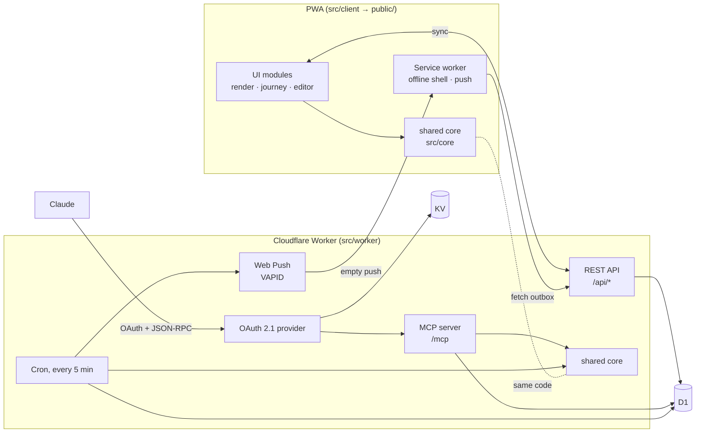

# Quest Log

[](https://github.com/jerry-vrabel-development/quest-log/actions/workflows/ci.yml)

A gamified, ADHD-friendly task tracker. Each quest has a **tiny first step** for when you feel frozen. Completing quests rolls **variable-ratio loot**, with a pity timer so a dry streak never lasts long. The app also has gentle streaks, a 1–10 mood check-in, badges, and a Journey tab that shows how mood and activity relate.

Written in **TypeScript** (strict). It is an installable PWA that works offline. A Cloudflare Worker adds device sync, push reminders that arrive while the app is closed, and a **Claude connector**: a remote MCP server behind OAuth 2.1, so an AI assistant can add, schedule and complete quests from a conversation.

**Live:** https://quest-log.forwardslash.workers.dev

## Design principles

Quest Log is deliberate behavior design, after trainer Karen Pryor's positive-reinforcement methods. The game mechanics, loot drops included, are there on purpose: to help the person using the app build the habits _they_ chose. Every feature is checked against these eight rules.

1. **Reward a behavior, not a verdict.** XP goes to specific, observable actions (finishing a quest, an honest check-in, two minutes on a tiny step), never to "having a good day." → [`rules.ts`](src/core/rules.ts) (`completeQuest`, `recordMood`, `recordFreeze`), [`dice.ts`](src/core/dice.ts)
2. **The user sets the criterion.** You write the quests, their tiny first steps and what they're worth. Nothing outside you defines success. → [`editor.ts`](src/client/editor.ts), [`quests.ts`](src/core/quests.ts) (input validation)
3. **Clear and immediate.** A marker click lands the instant you act, before any work happens, and the reward follows about 150 ms later. → [`actions.ts`](src/client/actions.ts) (`mark`), [`celebration.ts`](src/client/celebration.ts) (`REWARD_DELAY_MS`)
4. **Predictable while learning, variable once learned.** A repeating quest's first 5 completions always drop loot; after that, drops follow a variable-ratio schedule with a pity timer. → [`celebrate.ts`](src/core/celebrate.ts) (`HABIT_WARMUP`, `guaranteedDrop`), [`rules.ts`](src/core/rules.ts) (`rollLoot`)
5. **Bigger on hard days.** When your latest mood is 4 or under, every quest drops loot and the first one is a jackpot. → [`celebrate.ts`](src/core/celebrate.ts) (`isLowDay`)
6. **Never punishing.** Nothing is taken away. Streaks count gently, missed repeats roll forward instead of piling up, overdue quests come with "no guilt," and coming back after a break is its own celebrated moment. → [`streaks.ts`](src/core/streaks.ts), [`quests.ts`](src/core/quests.ts) (`rollMissed`), [`rules.ts`](src/core/rules.ts) (`streak`)
7. **Honesty over happiness.** A mood check-in pays the same XP whether you log a 3 or an 8, because the behavior being rewarded is the honest answer. → [`rules.ts`](src/core/rules.ts) (`MOOD_XP`)
8. **No money inside the reward loop.** Loot can't be bought, streaks can't be paid for, and there are no ads. Variable rewards are only ever pointed at the user's own goals. → by design: there is no payment code in the app.

## Architecture



**One rulebook, three callers.** The game rules live in `src/core/`: dates and repeats, XP curve, loot table, streaks, badges and reminder timing. They are pure, dependency-free TypeScript with no DOM or Worker APIs. esbuild bundles them into the browser app, and Wrangler bundles the same modules into the Worker. A quest completed through Claude, a reminder sent by the cron, and a checkbox ticked in the app all go through the same code.

**Types at the boundaries.** Anything that crosses a trust boundary (MCP tool arguments, API bodies, rows read back from D1, old saves in `localStorage`) arrives as `unknown` and is validated or normalized before the rest of the code sees it. Inside, the compiler holds the line: `strict`, plus type-aware ESLint (`strictTypeChecked`).

**Time-zone-safe dates.** Dates are `YYYY-MM-DD` strings in the user's calendar, and the math runs on UTC `Date`s. The phone, the Worker and CI therefore agree no matter where each one runs. The test suite runs under several machine time zones to prove it.

**Rewards follow Karen Pryor's training principles** (`src/core/celebrate.ts`). A marker click and a tiny buzz land the instant a quest is checked, before any work happens, and the payoff follows about 150 ms later, so the click itself becomes rewarding. New habits get continuous reinforcement: a repeating quest's first 5 completions always drop loot, then it moves to the variable schedule. Hard days pay more: when the latest mood is 4 or under, every quest drops loot, and the first one is a jackpot. Jackpots stay rare and are saved for breakthroughs (level-ups, badges, epic loot, 30+ XP quests, every 5th quest in a day, streak milestones). They open a full-screen loot chest with a drum roll, fanfare and confetti. Nothing is ever taken away: when a streak ends, the first step back is a **comeback**, which always drops loot, honors the run that ended ("Your 12-day streak is in the record, your second-longest"), and earns the Comeback badge. The HUD shows the longest run next to the current one. Sounds are synthesized with Web Audio, can be turned off in Settings, and animations respect `prefers-reduced-motion`.

**Memory drops: rewards made from your own record** (`src/core/memories.ts`). A reinforcer only works if the learner actually wants it, and nothing is more personal than your own past. So reward moments can also bring back a memory, chosen for the moment: on a hard day, how you got through before (notes from past you, comebacks, hard days you still moved on); after a quest, earlier wins in the same area; at a jackpot, one of your best days; and on an anniversary, whatever happened on this date. Hard days and jackpots always bring one; other moments sometimes do. Memories only lift: a low day comes back only as something you got through, and recent memories don't repeat. In the Journey tab you can write **notes from past you** on good days; they come back when you need them.

**Moments: capture when it's good, replay when it's not** (`src/core/moments.ts`, `src/client/moments.ts`, `src/client/media.ts`). Save a photo, a short video (up to a minute; on a phone you can shoot it right there), the song you were listening to (with its local music file attached, if you like), a quick recording made right in the app, or the movie you watched, with a caption, from Journey or from the "Save this moment?" invite that appears after a 7+ check-in, a jackpot or a comeback. Photos are resized on the device and kept in IndexedDB with videos (up to 60 seconds, played inline; phone clips over 20 MB or above 720p are shrunk on the device first, by replaying them into a 1280 px canvas recorded with MediaRecorder at a 720p bitrate, so a minute of 4K comes out around 20 MB), music files (up to 25 MB) and recordings (up to 2 minutes, Opus or AAC via MediaRecorder); players never autoplay; links must be http(s) and show where they're from (Spotify, YouTube, IMDb, …). Moments are the strongest memory drop: whenever one fits the moment, it wins. In a jackpot it appears inside the chest; otherwise it opens full screen.

**Encrypted cloud backup for moments** (`src/core/vault.ts`, `src/client/backup.ts`, `src/worker/media.ts`). With sync on, every moment file follows you to your other devices through Cloudflare R2, and it's encrypted on the device first. The key is derived from the sync code with HKDF-SHA-256 and never leaves the device; the server knows the account only by the code's SHA-256 hash. Each file is sealed with AES-256-GCM, with its MIME type inside the ciphertext and the moment id bound in as additional data, so the server can't read a file, tell what kind it is, or move it onto another moment without that being detected. Each account gets 2 GB (the free R2 tier is 10 GB). Deleting a moment deletes its file from the cloud, and files no moment uses any more are cleaned up after a day. Without sync, nothing leaves the device.

**The Log: check in when you want, never prompted** (`src/core/checkin.ts`, `src/client/log.ts`). A 📝 Log button sits in the progress panel on every tab. Mood (1-10) is the only required tap; folded under "More" are anxiety, energy, body and focus on five-step scales in words (Calm … Very high, Empty … Full, Rough … Strong, Scattered … Locked in), short notes on sleep and pain, a note, and a picture or GIF (GIFs are kept as they are so they still move; photos are resized). Nothing asks you to log, and nothing shows today's answer back to you afterwards: if you're a 2, you shouldn't see a 2 all day. The record keeps it all in Journey, check-in pictures are backed up encrypted with moments, and XP is once a day. Chosen steps show a check mark as well as a fill, never color alone. Claude can log the same extras through the connector.

**Share how I'm doing** (`src/core/report.ts`, `src/client/share.ts`). For when friends and family ask: Journey's 📤 button writes a short, honest update from the record for today, this week or this month, as a headline or a few lines. Mood is said in words, never as a number ("it's been a hard stretch", "mostly okay, with a couple of rough days"), along with what got done, energy, sleep and a highlight moment (its photo can go along). Anxiety, pain and notes stay out unless you turn them on. You see and can edit every word, then the phone's share sheet sends it, or Copy. The app itself never sends anything.

**Frozen? Roll the dice** (`src/core/dice.ts`, `src/client/dice.ts`). When you can't start anything, the Frozen button tosses a 3D die (pure CSS) that clacks as it bounces and lands on one tiny step from a quest that's due, or on a built-in step like "Drink a glass of water" when none are. You can roll again, or tap "Do it" to start a two-minute timer. Finishing pays 5 XP, and the Journey log records which tiny step broke the freeze. That's shaping: the smallest possible step gets rewarded.

**Opening and closing the app are rewarded too** (`src/client/session.ts`). A short opening screen shows your level and streak; tapping it plays a rising welcome chime. Browsers only allow sound after a tap, which is why the screen asks for one. Leaving the app plays a soft farewell (best effort, since mobile browsers may cut it off). Coming back after 30 minutes away shows the opening screen again. It can be turned off in Settings.

**Rewards stay where the user sees them.** When Claude completes a quest, the server adds the XP right away and queues a pending reward. The loot roll and badge check happen the next time the app opens, so the reward moment still happens in the app.

## Project layout

```
src/
  core/                     pure logic shared by the browser and the Worker
    types.ts                Quest, State, LogEvent (a discriminated union), ...
    dates.ts                calendar math, repeat rules, DST-aware zone conversion
    rules.ts                XP curve, streaks, loot roll, completing quests, moods
    celebrate.ts            Karen Pryor reward rules: how big each moment is (small, good, jackpot)
    dice.ts                 the Frozen? dice: which tiny steps to offer, rolls that never repeat
    streaks.ts              streak history, comebacks, and honoring a streak that ended
    moods.ts                editing and deleting mood check-ins, keeping XP honest
    memories.ts             memory drops: candidates from the record, chosen for the moment
    moments.ts              moments (photo, video, song, recording, movie): validation, links, how they're described
    vault.ts                end-to-end encryption for backed-up moment files (HKDF + AES-256-GCM)
    stats.ts                derived stats and badges
    quests.ts               views, sorting, roll-forward of missed repeats, input validation
    reminders.ts            when a reminder fires (used by app and cron)
    state.ts                fresh state, migrations, normalization
    ics.ts                  calendar export with alarms
  client/                   the PWA, bundled by esbuild into public/js/app.js
    main.ts                 entry point: wiring and boot
    actions.ts              marker → rules → reward, in that order
    celebration.ts          small, good and jackpot moments: toasts, confetti, the loot chest
    sound.ts                marker click and reward sounds, synthesized with Web Audio
    dice.ts                 the Frozen? dice: a 3D CSS die, bounce clacks, the two-minute timer
    session.ts              opening screen; welcome and farewell chimes
    moments.ts, media.ts    saving moments, files in IndexedDB, the Journey gallery and replay
    backup.ts               encrypted backup and restore of moment files when sync is on
    moodEdit.ts             fix or delete a mood check-in from the activity log
    render.ts, journey.ts, editor.ts, settings.ts, reminders.ts, sync.ts, ...
    sw.ts                   service worker → public/sw.js (cache name = content hash of the build)
  worker/                   the Cloudflare Worker
    worker.ts               entry: OAuth provider in front of /mcp, cron handler
    api.ts                  /api/* routes (sync, push subscriptions, outbox)
    media.ts                /api/media: encrypted moment files in R2, per-account quota
    authorize.ts            OAuth consent page (proves ownership with the sync code)
    mcp/server.ts           MCP over Streamable HTTP, stateless JSON-RPC 2.0
    mcp/tools.ts            tool schemas and implementations
    reminders.ts, push.ts   reminder cron and VAPID Web Push
    db.ts                   every SQL statement, in one place
public/                     static files: index.html, styles.css, manifest, icons (+ build output)
test/unit/                  core logic
test/worker/                API, MCP, cron, push and the full OAuth flow against real SQLite
e2e/                        Playwright tests on desktop and mobile viewports
worker-configuration.d.ts   Worker runtime and binding types, generated by `npm run types`
```

There are four TypeScript programs, because the code runs in different global scopes: the browser (`tsconfig.json`, DOM), the service worker (`tsconfig.sw.json`, WebWorker), the Worker plus unit tests (`tsconfig.worker.json`, workerd + Node), and the Playwright tests (`tsconfig.e2e.json`, Node + DOM).

## Accessibility

The target is **WCAG 2.2 AA**, and CI enforces it: `e2e/a11y.spec.ts` runs an [axe-core](https://github.com/dequelabs/axe-core) scan (WCAG 2.2 A/AA plus best practices) of every view and every dialog, in light and dark mode, on desktop and phone viewports. Any violation fails the build. Keyboard behavior that scanners can't see is tested directly.

- **Keyboard:** everything works without a mouse. Quests open in the editor with Enter; the views follow the WAI-ARIA tabs pattern (arrow keys, Home and End, roving tabindex); dialogs are native `<dialog>` elements, so focus is trapped while they're open, Escape closes them, and focus returns where it was. While the opening screen is up, the page behind it is `inert`, and focused items always scroll into view below the sticky progress panel, never underneath it.
- **Screen readers:** every control has a name ("Complete Drink a glass of water", "6 out of 10, Okay"), the current mood is exposed with `aria-pressed`, rewards are announced through a live region, and the page uses landmarks and an ordered heading outline.
- **Color and contrast:** all text meets 4.5:1 in both themes (gold has a separate, darker shade for text), and color is never the only signal; the Frozen? dice also mark each category with a shape.
- **Motion and sound:** animations respect `prefers-reduced-motion`, and sound and vibration can be turned off in Settings.

Still checked by hand: a VoiceOver pass on iPhone, 200% zoom, and text alternatives for the Journey charts (tracked in issues).

## Testing and quality

| Command                                                       | What it does                                                                                                                                                                                                                                                                                                                                                             |
| ------------------------------------------------------------- | ------------------------------------------------------------------------------------------------------------------------------------------------------------------------------------------------------------------------------------------------------------------------------------------------------------------------------------------------------------------------ |
| `npm test`                                                    | 248 Vitest tests: unit tests for the core, plus Worker tests that run the real `schema.sql` on Node's built-in SQLite through a small D1-compatible adapter                                                                                                                                                                                                              |
| `npm run test:e2e`                                            | 130 Playwright tests on Desktop Chrome and Pixel 7, including an axe-core accessibility scan of every view and dialog: first run, completing quests, the jackpot chest, marker-before-reward sound order, sound settings, reduced motion, mood check-ins and editing or deleting them, comebacks after a break, the editor, Journey, the Frozen dice, the opening screen |
| `npm run test:coverage`                                       | about 95% line coverage of `core/` and `src/`                                                                                                                                                                                                                                                                                                                            |
| `npm run lint` · `npm run format:check` · `npm run typecheck` | Type-aware ESLint (`strictTypeChecked`), Prettier, and `tsc` over all four programs                                                                                                                                                                                                                                                                                      |
| `npm run check`                                               | all of the above except e2e                                                                                                                                                                                                                                                                                                                                              |

Highlights:

- **OAuth end to end:** discovery → dynamic client registration → consent with the sync code → PKCE token exchange → authenticated MCP tool call, all through the real Worker entry point.
- **Loot math:** a seeded PRNG checks the drop rates against the published table over 50,000 rolls, and separate tests check the pity timer.
- **Bugs found during the refactor, now covered by tests:** monthly repeats from Jan 31 used to skip into March; calendar events at 11:45 PM ended before they started; a midnight timer wrote a stray field into synced state. The TypeScript migration caught one more: the reminder cron read saved state without normalizing it, so a quest from an older save with no `remind` field could fire at the wrong time.

CI runs everything on every push and pull request, including a check that `worker-configuration.d.ts` still matches `wrangler.jsonc`.

## Branches

`feature/*` → pull request into `dev` → pull request into `main`. Both `main` and `dev` are protected: changes land only through pull requests with CI green. Pushing to `main` deploys production.

## Claude connector (MCP)

`/mcp` is a remote MCP server (Streamable HTTP, stateless JSON-RPC) behind OAuth 2.1, implemented with [`@cloudflare/workers-oauth-provider`](https://github.com/cloudflare/workers-oauth-provider):

- **Discovery:** unauthenticated calls get a `401` with a `resource_metadata` pointer (RFC 9728). Authorization server metadata follows RFC 8414.
- **Client registration:** Dynamic Client Registration (RFC 7591) and Client ID Metadata Documents.
- **Sign-in:** `/authorize` is a consent page where the user enters their Quest Log **sync code**. The code is hashed and matched against D1, and the grant stores only that hash.
- **Tokens:** PKCE (S256), 1-hour access tokens, and rotating refresh tokens with a 60-day idle lifetime. Tokens are stored hashed in KV.

| Tool             | What it does                                                                                            |
| ---------------- | ------------------------------------------------------------------------------------------------------- |
| `list_quests`    | Now / upcoming / all / done views, with ids                                                             |
| `add_quests`     | Add up to 25 quests at once (validated all-or-nothing); `done: true` records something already finished |
| `complete_quest` | Completes by id; repeating quests roll forward                                                          |
| `update_quest`   | Rename, reschedule, change the tiny step, etc.                                                          |
| `delete_quest`   | Delete by id (marked destructive)                                                                       |
| `log_mood`       | 1–10 check-in with an optional note                                                                     |
| `get_summary`    | Level, streak, quests and mood per day over N days                                                      |

**Connect it to Claude:** Settings → Connectors → **Add custom connector** → URL `https://<your-worker-host>/mcp` → Connect, then enter your sync code (in the app: Settings → Show sync code).

## How sync and push work

- **No accounts.** The app generates a random 256-bit **sync code**, and the server stores only its SHA-256 hash. To link a second device, paste the code into it.
- **Sync** is last-write-wins with a `409` guard: if another device saved something newer, the client pulls before it pushes.
- **Push** needs no payload encryption library. Every 5 minutes the cron finds due reminders in each user's own time zone, writes them to an outbox, and sends an **empty**, VAPID-signed push. The service worker wakes up, fetches the outbox and shows the notifications.

## Deploy

You need Node 22+ and a Cloudflare account. Everything fits in the free tier.

```bash
npm install
npx wrangler login

npx wrangler d1 create quest-log            # put the database_id in wrangler.jsonc
npm run db:init
npx wrangler kv namespace create OAUTH_KV   # put the id in wrangler.jsonc
npx wrangler r2 bucket create quest-log-media  # enable R2 in the dashboard first (free tier: 10 GB)
npm run vapid                               # public key → wrangler.jsonc vars.VAPID_PUBLIC_KEY
npx wrangler secret put VAPID_PRIVATE_JWK   # paste the private key JSON
npm run deploy
```

Also set `VAPID_SUBJECT` in `wrangler.jsonc` to an email address you check.

## Local development

```bash
npm run db:init:local
echo "VAPID_PRIVATE_JWK='<private key json>'" > .dev.vars
npx wrangler dev --test-scheduled           # http://localhost:8787
curl "http://localhost:8787/__scheduled?cron=*/5+*+*+*+*"   # run the reminder cron by hand

npm run build:watch                         # rebuild the PWA on save (wrangler dev also builds on start)
npm run serve:static                        # just the PWA, offline mode, on :4173 (after npm run build)
npm run types                               # regenerate worker-configuration.d.ts after editing wrangler.jsonc
```

## Notes

- Reminders: a quest with no time set reminds at 9:00 AM. Each occurrence fires once, and reminders stop 6 hours after the due time.
- Repeating quests roll forward when completed or missed, so skipped days don't pile up as overdue.
- Calendar export (.ics) and the JSON backup work with or without sync.
